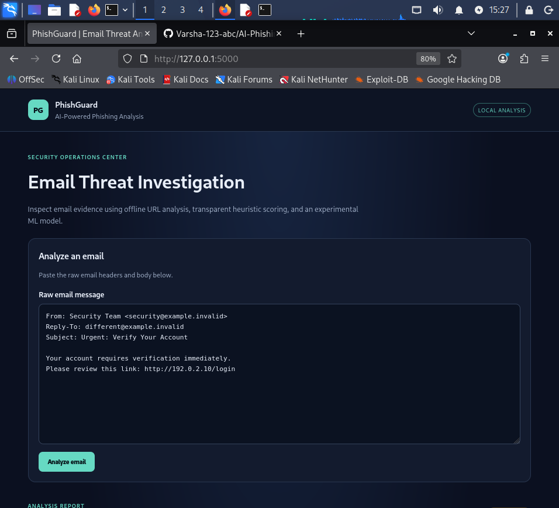
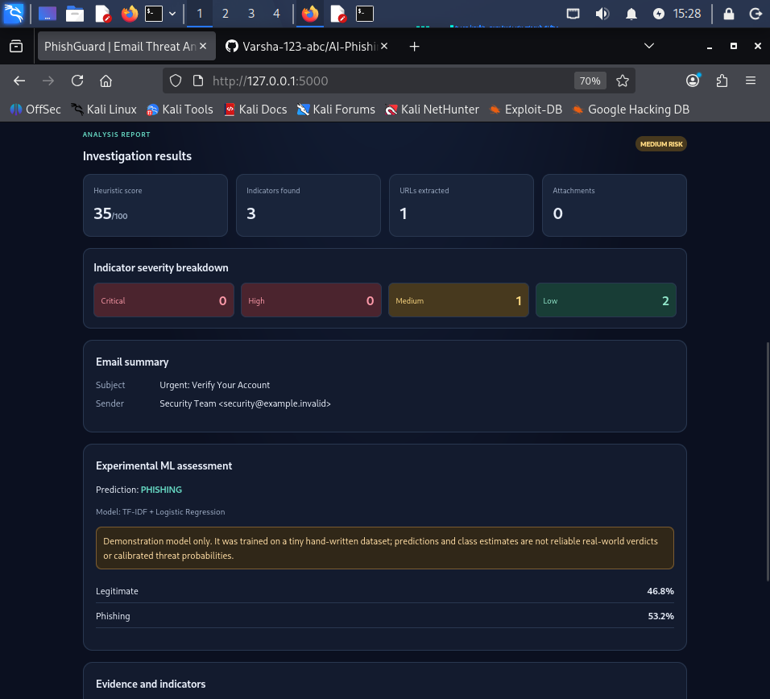
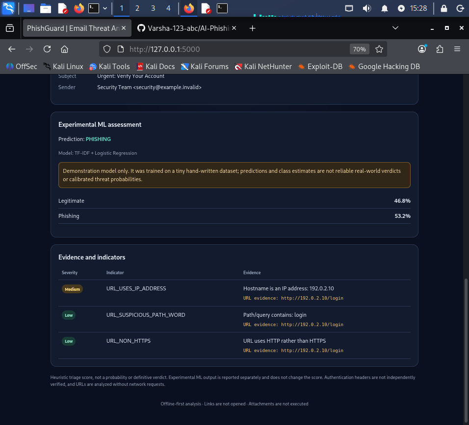

# PhishGuard: AI-Powered Phishing Detection & Email Threat Analysis

PhishGuard is a defensive cybersecurity project designed to support phishing-email triage and SOC investigations. It combines offline email parsing, suspicious URL analysis, evidence-based heuristic scoring, and experimental machine-learning classification.

## Features

- Offline parsing of email messages and `.eml` content.
- Email header inspection and sender/Reply-To domain mismatch indicators.
- URL extraction and suspicious URL pattern analysis without visiting links.
- Explainable heuristic risk scoring from 0 to 100 with severity classification.
- TF-IDF and Logistic Regression phishing classification.
- Separate demonstration and larger-dataset model workflows.
- Flask dashboard for email analysis and evidence review.
- SQLite analysis history with investigation notes.
- CSV export of analysis history and PDF export of individual analysis reports.
- Automated tests for parsing, URL analysis, risk scoring, ML, history, and dashboard routes.

## Technology Stack

- Python, Flask, SQLite
- scikit-learn, TF-IDF, Logistic Regression, joblib
- ReportLab for PDF reports
- HTML and CSS
- Python `unittest`

## Project Structure

```text
AI-Phishing-Detection-System/
├── app/
│   ├── routes/
│   ├── services/
│   ├── static/
│   └── templates/
├── core/
│   ├── email_analysis/
│   ├── url_analysis/
│   ├── threat_scoring/
│   └── ml/
├── database/
├── datasets/
│   ├── demo_emails.csv
│   └── processed/
├── reports/
│   └── ml/
├── tests/
├── requirements.txt
├── run.py
└── README.md
```

## Requirements

- Python 3.10 or later
- pip

Developed and tested with Python 3.13.

## Installation

Run these commands from the project directory:

```bash
python -m venv .venv
source .venv/bin/activate
python -m pip install --upgrade pip
python -m pip install -r requirements.txt
```

## Run the Dashboard

Start the application:

```bash
python run.py
```

Open `http://127.0.0.1:5000` in your browser. Stop the development server with `Ctrl+C`.

Paste or submit email content for analysis. Review the available evidence and risk indicators rather than relying on a classification alone.

## Machine-Learning Workflows

### Demonstration model

Train the small demonstration model:

```bash
python -m core.ml.train_model
```

This workflow uses only 12 hand-written examples. Its tiny evaluation set is not representative of real-world phishing traffic and must not be used to claim operational accuracy.

### Larger dataset preparation

The larger-data workflow expects a source CSV at `~/Downloads/Balanced_Dataset.csv`, with `body` and `label` columns. The documented labels are `0` for legitimate and `1` for phishing.

Prepare the dataset:

```bash
python -m core.ml.prepare_dataset
```

The processed dataset is written to `datasets/processed/balanced_emails.csv`. Review the preparation script and the source dataset's provenance and licensing before use.

### Train the larger model

```bash
python -m core.ml.train_large_model
```

The workflow writes generated model and evaluation artifacts under `reports/ml/`, including `balanced_phishing_model.joblib` and `balanced_evaluation.json`.

The evaluation uses a stratified random train/test split. Related messages, duplicate content, source overlap, or campaign overlap may inflate results. Independent, time-based or source-based validation is needed before drawing operational conclusions. Model probabilities are not calibrated threat probabilities.

Generated models, reports, and processed research data are local artifacts and are excluded from Git.

## Analysis History and Reports

- View previously recorded analysis summaries in the history interface.
- Add investigation notes to support case review.
- Export analysis history as CSV.
- Export an individual analysis report as PDF.

The history database stores analysis summaries and structured findings rather than the original email bodies. Treat exported reports and investigation notes as potentially sensitive.

## Run Tests

From the project root, with the virtual environment activated:

```bash
python -m unittest discover -v
```

## Machine-Learning and Detection Limitations

- Automated findings are indicators for investigation, not proof of maliciousness.
- A legitimate-looking message can still be malicious, and suspicious patterns can occur in legitimate messages.
- Model quality depends on the source data, labels, preprocessing, and evaluation method.
- The demonstration model's metrics are highly unstable because the dataset is extremely small.
- The larger model's random-split metrics do not establish generalization to new senders, campaigns, or future messages.

## Security and Responsible Use

- Treat email content, headers, and URLs as untrusted input.
- Do not execute attachments or automatically open suspicious links.
- The application analyzes URL patterns without needing to visit the URLs.
- Keep the application local during development and configure appropriate security controls before deployment.
- Analyze only messages and systems you are authorized to examine.
- Avoid placing confidential email content or sensitive personal information in test datasets or public repositories.

## Dashboard Screenshots

### Dashboard Overview



### Sample Email Analysis



### Additional Analysis Results


